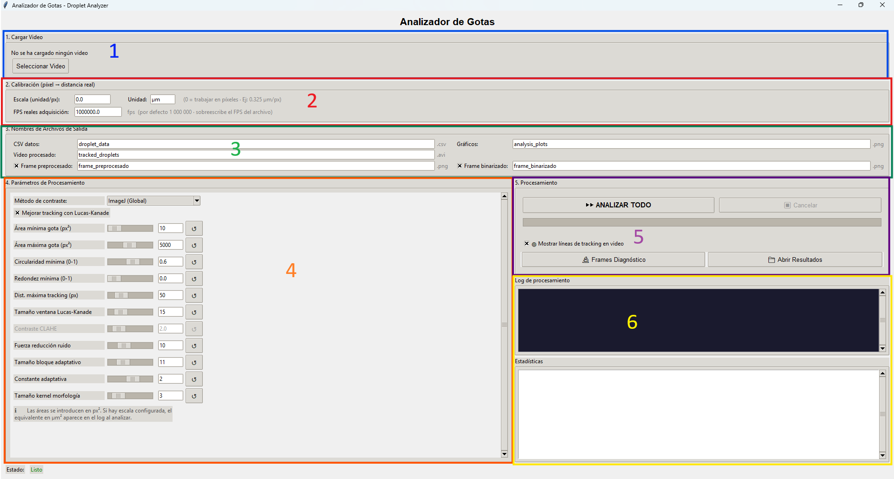

# Droplet Analyzer

Droplet Analyzer (DA) is an open-source desktop application for the automated detection, sizing, tracking, and velocity estimation of droplets in ultra-high-speed (UHS) backlit videos of sprays. It is built on [OpenCV](https://opencv.org) and has a graphical interface, so it can be used without programming.

For each droplet and frame, DA exports the centroid position, projected area, equivalent diameter, circularity, roundness, and the two velocity components to a CSV file. It also generates summary plots and an annotated video with the detections and trajectories.



## Contents

- [Installation](#installation)
- [Using the graphical interface](#using-the-graphical-interface)
- [Using DA from Python](#using-da-from-python)
- [Output files](#output-files)
- [How it works](#how-it-works)
- [Reproducing the validation of the article](#reproducing-the-validation-of-the-article)
- [Repository structure](#repository-structure)
- [Citation](#citation)
- [License](#license)

## Installation

DA requires **Python 3.10 or later**. It has been tested on Windows 11 with Python 3.13, OpenCV 4.12, NumPy 2.2, and pandas 2.3.

1. Clone the repository:

   ```bash
   git clone https://github.com/carperca23/droplet-analyzer.git
   cd droplet-analyzer
   ```

2. Create and activate a virtual environment (recommended):

   ```bash
   python -m venv .venv
   # Windows
   .venv\Scripts\activate
   # Linux / macOS
   source .venv/bin/activate
   ```

3. Install the dependencies:

   ```bash
   pip install -r requirements.txt
   ```

The graphical interface uses `tkinter`, which is included with the standard Python installers for Windows and macOS. On Linux it may need to be installed separately, for example `sudo apt install python3-tk` on Debian/Ubuntu.

## Using the graphical interface

Start the application with:

```bash
python main.py
```

The interface is available in Spanish and English (selector in the top-right corner) and is organized in the numbered sections shown in the screenshot above:

1. **Load video.** Select the recording (`.avi`, `.mp4`, `.mov`, `.mkv`).
2. **Calibration.** Enter the spatial scale (physical units per pixel, e.g. `5.32` µm/px) and the real acquisition rate in frames per second. The frame rate stored in UHS video files is usually not the acquisition rate, so it must be entered here; the default is 1,000,000 fps. With a scale of 0, all results are given in pixels.
3. **Output file names** for the data CSV, plots, annotated video, and diagnostic frames.
4. **Processing parameters.** Contrast method (CLAHE or percentile stretching), Lucas–Kanade prediction, and the segmentation, filtering, and tracking parameters described in [How it works](#how-it-works). Each parameter can be reset to its default value.
5. **Processing.** Run the analysis, follow it in the preview window, and open the results folder. The *Diagnostic frames* button saves the preprocessed and binarized versions of the first frame, which is the quickest way to tune the parameters before processing a whole video.
6. **Log and statistics** of the processed video.

Results are written to the `output/` folder of the working directory.

### Recommended workflow for tuning parameters

1. Load a representative video and save the diagnostic frames.
2. Adjust the contrast method, denoising strength, and adaptive-threshold parameters until the droplets appear as filled, well-separated regions in the binarized frame.
3. Adjust the minimum area and circularity to discard noise and non-droplet objects.
4. Set the maximum tracking distance slightly above the largest expected displacement between consecutive frames, in pixels.
5. Keep the same parameters for all videos of an experimental series, so that results are comparable.

## Using DA from Python

The processing engine can be used without the interface:

```python
from droplet_analyzer import DropletAnalyzer

analyzer = DropletAnalyzer("video.avi", output_dir="output")

# Processing parameters (see scripts_testeo/experiment_config.py for the values used in the article)
analyzer.set_parameter("use_clahe", True)
analyzer.set_parameter("denoise_strength", 30)
analyzer.set_parameter("adaptive_block_size", 11)
analyzer.set_parameter("adaptive_c", 5)
analyzer.set_parameter("morphology_kernel_size", 3)
analyzer.set_parameter("min_droplet_area", 15)
analyzer.set_parameter("max_tracking_distance", 15)

analyzer.set_scale(5.32, "µm")   # spatial calibration (µm per pixel)
analyzer.set_fps(1_000_000)      # acquisition rate

analyzer.process_video(output_video="output/tracked.avi")   # output_video is optional
df, csv_path = analyzer.export_results("droplet_data.csv", lang="en")

print(analyzer.get_statistics())
print(analyzer.get_timing_summary())   # frames per second and time per pipeline stage
```

`process_video` also accepts a `frame_callback(frame_idx, frame, preprocessed, binary, droplets)` function, which is called on every frame and can return an annotated image to write to the output video.

## Output files

| File | Content |
|---|---|
| `droplet_data.csv` | One row per detection (see columns below) |
| `analysis_plots.png` | Distributions of diameter, area, circularity, roundness, and velocity, and their correlations |
| `droplet_data_*.csv` | Data behind each plot, for use in other software |
| `tracked_droplets.avi` | Video with detections, equivalent diameters, and trajectories |
| `frame_preprocesado.png`, `frame_binarizado.png` | Diagnostic frames |

Columns of the data CSV (English headers; `<u>` is the unit set in the calibration, or `px`):

| Column | Description |
|---|---|
| `track_id` | Identifier of the reconstructed trajectory |
| `frame`, `time_s` | Frame index and time (s) |
| `x_<u>`, `y_<u>` | Centroid position |
| `area_<u>2`, `diameter_<u>` | Projected area and equivalent diameter, `d = 2·sqrt(A/π)` |
| `circularity`, `roundness` | `4πA/P²` and `4A/(π·MA²)`, with `MA` the major axis of the fitted ellipse |
| `velocity_x_<u>_s`, `velocity_y_<u>_s`, `velocity_magnitude_<u>_s` | Velocity from this detection to the next detection of the same track (empty for the last detection of each track) |

Velocities are projected, two-dimensional velocities in the image plane.

## How it works

Each frame goes through the following stages:

1. **Preprocessing.** Grayscale conversion, contrast enhancement (CLAHE with an 8 × 8 tile grid, or stretching between the 0.4 and 99.6 percentiles), and Fast Non-Local Means denoising (`cv2.fastNlMeansDenoising`).
2. **Segmentation.** Gaussian adaptive thresholding for dark droplets on a bright background (`cv2.adaptiveThreshold`, `THRESH_BINARY_INV`), followed by morphological opening and closing with an elliptical structuring element.
3. **Contours and filtering.** Contour extraction in two passes (hole filling, then measurement), and rejection of objects outside the area range or below the minimum circularity and roundness.
4. **Features.** Area, perimeter, equivalent diameter, circularity, roundness, centroid (image moments), and bounding box.
5. **Tracking.** The position of each active trajectory is predicted with pyramidal Lucas–Kanade optical flow, and each detection is assigned to the nearest free trajectory within the maximum tracking distance. A trajectory is closed after five frames without detections.
6. **Velocities.** Finite differences of the centroid positions of consecutive detections of each track, divided by the elapsed time.

Preprocessing, dominated by Non-Local Means denoising, takes about 99 % of the processing time. On an Intel Core i7-9700F, DA processes 312 × 260 px HPV-2 recordings at about 9 frames per second.

## Reproducing the validation of the article

The `scripts_testeo/` folder contains the code used for the quantitative validation with synthetic videos. All scripts are run from the repository root.

```bash
# 1. (Optional, about 1 h on 8 cores) Parameter sweep on an independent tuning set.
#    The selected values are already stored in scripts_testeo/experiment_config.py.
python scripts_testeo/tune_parameters.py --out_dir tuning

# 2. Generate the synthetic dataset (E1–E5), run DA on it, and compute the metrics.
python scripts_testeo/run_experiments.py --synth_dir synthetic_dataset --results_dir results

# 3. Figures of the article (Fig. 5 and Fig. S1).
python scripts_testeo/make_paper_figures.py --results_dir results --tuning_dir tuning --out_dir figures

# 4. Processing speed on your own recordings.
python scripts_testeo/benchmark.py path/to/video.avi --repeats 3 --out results/benchmark.csv
```

The synthetic videos contain dark droplets with a Gaussian-smoothed edge on a bright background, with exactly known positions, diameters, and velocities. They are generated with fixed random seeds and stored with a lossless codec (FFV1), so the dataset is identical every time it is generated. Step 2 writes one `E*_metrics.csv` file per experiment and `TableS1_parameters.csv` with the processing configuration. The metrics are defined in `scripts_testeo/droplet_evaluator.py`.

| Experiment | Purpose |
|---|---|
| E1 | Sizing accuracy for static droplets of 6–50 px without noise |
| E2 | Velocity accuracy for whole-pixel, sub-pixel, and slow displacements, with and without noise |
| E3 | Robustness to Gaussian and salt-and-pepper noise |
| E4 | Detectable size range (3–80 px) |
| E5 | Tracking with 5–50 simultaneously moving droplets |

## Repository structure

```
main.py                    Entry point of the graphical interface
gui_app.py                 Graphical interface (tkinter)
droplet_analyzer.py        Processing engine: preprocessing, segmentation, tracking, export
plotter.py, plot_editor.py Summary plots and interactive plot editor
scripts_testeo/
    synthetic_video_generator.py  Synthetic videos with ground truth (E1–E5)
    droplet_evaluator.py          Comparison of DA output with the ground truth
    experiment_config.py          Processing parameters of the validation (Table S1)
    tune_parameters.py            Parameter sweep on the tuning set
    run_experiments.py            Full validation pipeline
    benchmark.py                  Processing speed and time per stage
    make_paper_figures.py         Figures of the article
    plot_experiment.py, generar_imagenes.py, histogramas.py
                                  Auxiliary scripts used for the figures of the thesis
figures/                   Figures generated for the article
docs/                      Images used in this README
```

## Citation

If you use Droplet Analyzer in your work, please cite the accompanying article (submitted):

> C. Pérez-Cantalapiedra, M. Carranza-García, L. B. Modesto-López. *An automated computer vision framework for the systematic sizing and kinematic analysis of multiple droplets in ultra-high-speed videos.* Submitted to Aerosol Research, 2026.

and the software itself:

> C. Pérez-Cantalapiedra, M. Carranza-García, L. B. Modesto-López. *Droplet Analyzer* (v1.0.0) [code]. idUS – Depósito de Investigación de la Universidad de Sevilla, https://doi.org/ (DOI pending), 2026.

Citation metadata for the software is provided in [`CITATION.cff`](CITATION.cff). Version 1.0.0 is archived in [idUS](https://idus.us.es), the institutional repository of the University of Seville, which assigns its DOI.

## License

Droplet Analyzer is released under the [MIT License](LICENSE).

## Acknowledgements

Droplet Analyzer was developed as a Bachelor's thesis at the University of Seville (ETSII), in collaboration with the Department of Aerospace Engineering and Fluid Mechanics. L. B. Modesto-López acknowledges support from project PID2022-140951OB-C21 (MCIN/AEI/10.13039/501100011033), and M. Carranza-García from grant PID2023-146037OB-C21 (MICIU/AEI/10.13039/501100011033).
